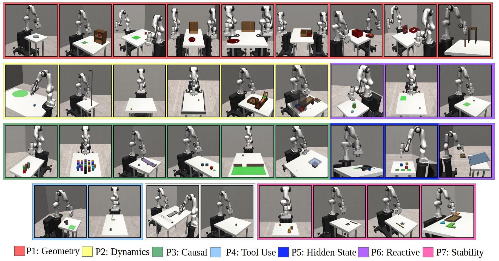
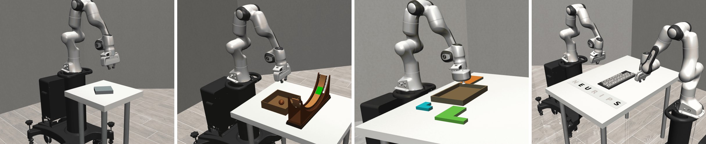

<div align="center">

<picture>
  <source media="(prefers-color-scheme: dark)" srcset="docs/assets/imbench_logo_dark.png">
  
</picture>

### A Benchmark for Intuitive Robotic Manipulation

**Conference on Robot Learning (CoRL) 2026**

Anurag Maurya · Sukhvansh Jain · Prajwal Avhad · Gautham Balachandran · Ziyi Zhou · Atharva Kshirsagar · Satyam Singh · Bowen Li · Rishabh Mukund · Ritul Singh · Jatin Vira · Suvonil Chatterjee · Devesh K. Jha

Neomanav Robotics, Bengaluru, India

[](https://imbench.org)
[](https://arxiv.org/abs/2607.15641)


[](LICENSE)



<sub>The 35 IMBench tasks across seven categories: geometry (P1), dynamics (P2), causal chains (P3), tool use (P4), hidden state (P5), reactive replanning (P6) and stability (P7), plus two miscellaneous tasks (grey).</sub>

</div>

---

Humans combine reasoning and motor control to solve manipulation tasks under diverse constraints. We call this capability **intuitive manipulation**. Existing benchmarks evaluate physical reasoning in isolation from execution, or measure policy performance without requiring explicit reasoning. **IMBench** evaluates intuitive manipulation as one integrated capability: perception, physical reasoning, action generation and iterative execution. Its tasks require an agent to infer task-relevant physical structure and produce feasible actions under explicit constraints, including contact-rich manipulation, tool use and multi-stage dependencies.

<p align="center">
  
  <br>
  <sub>Edge slide (P1) · Galileo ramp drop (P2) · Packing (P7) · Bimanual keyboard typing (M)</sub>
</p>

## Highlights

- **35 tasks in 7 physical-reasoning categories plus 2 miscellaneous tasks**, each built around one inference bottleneck. They range from single-arm grasping to homogeneous and heterogeneous (suction + jaw) bimanual manipulation.
- **Out-of-distribution `-v2` variants** of 13 tasks (8 of them evaluated in the paper) for testing generalization.
- **~14K curated trajectories**: 6K teleoperated and 8K scripted, in LeRobot format. *The dataset is releasing soon.*
- **Tools to generate more data**: teleoperation (keyboard, gamepad, SpaceMouse, Meta Quest), scripted oracles, an annotation dashboard and a post-processing pipeline.
- **One Gymnasium-compatible interface** on [MuJoCo](https://mujoco.readthedocs.io/) and [robosuite](https://robosuite.ai/), with RGB cameras, proprioception, wrist force/torque and tactile sensing.

| Category | Inference bottleneck | Tasks |
|---|---|:---:|
| **P1** Geometry and constrained grasping | Make objects graspable; reason about geometry and sub-goal order | 9 |
| **P2** Dynamics and trajectory prediction | Goals beyond static reach, moving objects, forward simulation | 7 |
| **P3** Causal and indirect action | Act through an intermediary chain when the target is unreachable or contact-forbidden | 6 |
| **P4** Tool use and augmented reach | Use a tool, or act before the final grasp | 2 |
| **P5** Hidden state and active discovery | Gather information that passive vision cannot see | 2 |
| **P6** Reactive replanning | Detect and recover from mid-execution disturbances | 3 |
| **P7** Stability and equilibrium | Static balance and precision under low tolerance | 4 |
| **M** Miscellaneous | Mirrored observations; partial completion by a second arm | 2 |

The full task list, the paper-number-to-task-ID mapping and the observation and action spaces are in **[docs/info/tasks.md](docs/info/tasks.md)**. Browse every task and sample episodes on the **[project website](https://imbench.org)**.

## Contents

- [Installation](#installation)
- [Quick Start](#quick-start)
- [Tasks](#tasks)
- [Teleoperation](#teleoperation)
- [Data Collection & Replay](#data-collection--replay)
- [Data Annotation](#data-annotation)
- [Post-Processing Pipeline](#post-processing-pipeline)
- [Policy Interface & Evaluation](#policy-interface--evaluation)
- [Project Structure](#project-structure)
- [Key Conventions](#key-conventions)
- [Citation](#citation)
- [Contact](#contact)
- [License & Acknowledgements](#license--acknowledgements)

---

## Installation

Requires Python 3.11–3.13 on Linux.

> [!IMPORTANT]
> IMBench is **source-install only**. Its YAML task configs (`configs/`) and mesh/asset dependencies (`deps/`) live alongside the `imbench/` package rather than inside it. Always install from a full git checkout with `pip install -e .`. A non-editable install (`pip install .`, a wheel or an sdist) still imports, but `ib.make()` cannot find the task configs and raises.

```bash
# deps/ycb (YCB object meshes) is a git submodule and is NOT populated by a plain `git clone`.
# If you already cloned without --recurse-submodules, run `git submodule update --init --recursive`.
git clone --recurse-submodules https://github.com/manav-robotics/imbench-release.git
cd imbench-release

# Create and activate a virtual environment
uv venv --python 3.12
source .venv/bin/activate

# Install dependencies + package
uv pip install -r requirements.txt
uv pip install -e .

# Optional extras
uv pip install -e ".[teleop]"   # keyboard / spacemouse / gamepad
uv pip install -e ".[data]"     # post-processing + collection dashboard (pandas, av, tqdm, flask)
```

On a headless machine, select an offscreen GL backend before rendering camera
observations: `export MUJOCO_GL=egl` (GPU) or `export MUJOCO_GL=osmesa` (CPU).

---

## Quick Start

```python
import imbench as ib

# List all registered tasks
print(ib.list_tasks())

# Create a task
# render_mode="human" opens the MuJoCo viewer and needs a display; use render_mode=None when headless
env = ib.make("ib-p2-cube-toss-v1", render_mode="human", obs_mode="combo")

# Standard interaction loop
obs, info = env.reset(seed=0)
for _ in range(200):
    action = env.action_space.sample()  # 7-D single-arm, 14-D bimanual
    obs, reward, terminated, truncated, info = env.step(action)
    env.render()
    if terminated or truncated:
        break
print(info["task_score"], info["is_success"])
env.close()
```

`reward` is sparse: `1.0` on steps where the task's success condition
(`info["is_success"]`) holds, else `0.0`. `info["task_score"]` is a progress
score in `[0, 1]`. It is dense for every task except `ib-p2-galileo-ramp-drop-v1` /
`-v2`, where it is binary. Partial credit can approach `1.0` without success,
so always use `is_success` for success rates. Pass
`config_overrides={"reward_type": "dense"}` to `ib.make()` to return the task
score as `reward`, or `reward_fn=f` to return `f(task, raw_obs)`.

Tasks are also registered with Gymnasium: `gymnasium.make("ib-p2-cube-toss-v1")`.
The 13 `-v2` variants are registered as `imbench-ood/<task-id>`,
e.g. `gymnasium.make("imbench-ood/ib-p1-edge-slide-v2")`, so that Gymnasium does not
offer them as upgrades of the `-v1` tasks; `ib.make()` ids are unchanged.

---

## Tasks

All tasks share an interface defined in `BaseTask`. Each is registered by ID and instantiated via `ib.make()`.

50 tasks are registered (`ib-<category>-<name>-v<version>`):
- 35 form the paper's benchmark suite.
- 13 are `-v2` out-of-distribution variants.
- 2 are extra non-paper examples.

The `ib-p1`...`ib-p7`/`ib-m` prefix encodes the **physical phenomenon** being tested (see the [category table](#highlights)). It does not say which directory or arm configuration a task uses: one category can mix single-arm, homogeneous-bimanual ("HoBi") and heterogeneous-bimanual ("HetBi") tasks.

Full task list (all 50, organized by phenomenon), the paper-number-to-task-ID mapping, action/observation space details, and configuration reference: **[docs/info/tasks.md](docs/info/tasks.md)**

> [!NOTE]
> **Galileo Ramp Drop** (`ib-p2-galileo-ramp-drop-v1` / `-v2`) runs at a **low control frequency (20 Hz)** on purpose, so the ball's roll through the curved trough plays out slowly enough for a human teleoperator to watch and react. `ib-m-freeform-v1` also runs at 20 Hz; all other tasks run at 100 Hz. If you build a policy or data-collection pipeline that assumes 100 Hz, override `control_freq` in the task YAML for this task.

**Contributing a new task.** Every task needs:
- a task class;
- a YAML config under `configs/tasks/`;
- an entry in `TASK_REGISTRY` (`imbench/registry.py`); nothing is auto-registered.

[docs/info/tasks.md](docs/info/tasks.md) documents the config keys.

---

## Teleoperation

Built-in support for keyboard, gamepad, 3D SpaceMouse, and Meta Quest VR hand tracking. The Quest device needs a companion Unity app that has not been publicly released yet; keyboard, gamepad and SpaceMouse work out of the box.

```python
from imbench.teleop import make_teleop

teleop = make_teleop("keyboard")   # or "gamepad", "spacemouse", "quest"
teleop.start()
result = teleop.get_action(obs)    # {"action": (7,) array, "paused": bool}
action = result["action"]
paused = result["paused"]          # True when operator is idle
teleop.stop()
```

| Device | Name | Requirements |
|--------|------|--------------|
| Keyboard | `keyboard` | `pynput` + an X display |
| Gamepad (Flydigi / any standard) | `gamepad` | `evdev` + Linux `input` group |
| 3D SpaceMouse | `spacemouse` | `pyspacemouse` |
| Meta Quest VR | `quest` | UDP stream from the companion Quest app (not yet publicly released) |

`import imbench.teleop` works without these dependencies (e.g. on a headless machine); a missing dependency is reported when that device is created or started.

Full device list, keyboard and gamepad controls, and custom device guide: **[docs/info/teleop.md](docs/info/teleop.md)**

---

## Data Collection & Replay

Collect demonstrations via teleoperation **or** scripted policies, and replay them in the simulator. Run `python scripts/setup_machine.py` once per machine first (see [Post-Processing Pipeline](#post-processing-pipeline)).

```bash
# ── Teleop (LeRobot v2.1 format) ─────────────────────────────────
# Collect 2 episodes with a gamepad → demos/ib-p1-edge-slide-v1/M<id>/
python scripts/collect_demos.py --task ib-p1-edge-slide-v1 --teleop gamepad --n 2 --render

# ── Scripted policies (failed attempts are discarded) ────────────
python data_synthetic/singlearm_collect_demos.py --task-id ib-m-mirror-pick-place-v1 --n-episodes 10
python data_synthetic/bimanual_collect_demos.py --task-id ib-m-keyboard-typing-v1 --n-episodes 5 --out-dir demos_synthetic/
python -m data_synthetic.hetbi_scripted.collect --task ib-p1-bowl-table-v1 --n-episodes 5

# ── Replay (resets with the episode's recorded seed) ─────────────
python scripts/replay_episode.py demos/ib-p1-edge-slide-v1/M01/
python scripts/replay_episode.py demos/ib-p1-edge-slide-v1/M01/ --episode 3
```

**Teleop collection** (`collect_demos.py`):
- An episode is **saved when the task terminates**.
- **Escape** (gamepad **B**) **discards** the current attempt and restarts the scene.
- Ctrl-C (or **Q** in the dashboard window) stops collection and keeps every saved episode.
- Output goes to `<out-dir>/M<machine_id>/` (default `--out-dir`: `demos/<task-id>`).
- Episodes are reset with seeds from `machine_id × 1,000,000`, continuing after the largest seed already in the dataset.
- The camera dashboard is on unless `--no-dashboard` is given. It is skipped when no display is available (`DISPLAY` unset); `--render` needs a display.

**Scripted collectors**:
- Output goes to `<out-dir>/<task-id>/M<machine_id>/` (default `--out-dir`: `demos/`).
- Only episodes that end in success (`info["is_success"]`) are saved, each with its reset seed.
- New episodes are appended to an existing dataset.
- [data_synthetic/README.md](data_synthetic/README.md) lists the collector for each task; `-v2` tasks have no scripted demos.

<details>
<summary><b>Scripted-collector flags</b></summary>

| Flag | Effect |
|------|--------|
| `--n-episodes <int>` | Successful episodes to save (default 40 single-arm, 10 otherwise); at most `max(10·N, N+20)` attempts; non-zero exit status if fewer succeed |
| `--out-dir <path>` | Output root; episodes go to `<out-dir>/<task-id>/M<machine_id>/` (default `demos/`) |
| `--render` | MuJoCo viewer plus observation dashboard unless `--no-dashboard` (needs a display) |
| `--max-steps <int>` | Override the YAML `max_episode_steps` |
| `--seed <int>` | Seed of the first attempt; attempt k uses seed + k (default `machine_id × 1,000,000`) |
| `--obs-mode` | `combo` (default), `proprio`, `rgb` |
| `--save-npy` | Also write raw actions to `npy/traj_NNNNNN.npy` |

The same flags work for `bimanual_collect_demos.py` and `hetbi_scripted/collect.py`. The het-bi collector takes `--task` / `--all` instead of `--task-id`, and adds `--no-lerobot` (a dry run that writes nothing unless `--save-npy` is given) and `--verbose`. [data_synthetic/README.md](data_synthetic/README.md#flags) describes the shared flags in detail.

</details>

Key features:
- **Pause detection**: idle frames (no operator input) are skipped, keeping the dataset clean for policy training. After a gripper command the sim keeps stepping in place for 0.5 s so the gripper finishes moving.
- **Action smoothing**: a low-pass filter and delta clamp are applied before `env.step()`, configured under `action_filter` in `configs/teleop/gamepad.yaml`.
- **Multi-rate recording**: each stream has its own save frequency (cameras at 25 Hz, proprio at 100 Hz, etc.).
- **Resume**: re-running on the same output directory appends new episodes, and `meta/info.json` is rewritten after every saved episode. A second collector on the same directory, or one with a different obs mode or cameras, exits with an error.
- **Reproducible replay**: `collect_demos.py` stores each episode's reset `seed` and `warmup_steps`, which `replay_episode.py` uses.
- **No telemetry by default**: episode reports to a collection dashboard are sent only if `DASHBOARD_API_URL` or `~/.imbench/dashboard.json` is set.

CLI arguments, dataset layout, and replay options: **[docs/info/data_collection.md](docs/info/data_collection.md)**

---

## Data Annotation

Review collected demonstrations and rate each episode from 1 (worst) to 5 (best) following [data_verification/rubric.md](data_verification/rubric.md).

```bash
# Launch annotation dashboard (auto-resumes from the first un-rated episode)
python -m data_verification demos/ib-p1-edge-slide-v1/M01/

# Start at a specific episode, track annotator name
python -m data_verification demos/ib-p1-edge-slide-v1/M01/ --episode 3 --annotator alice
```

The dashboard shows all camera feeds side by side with playback controls (play/pause, scrub, seek). Ratings are saved to `annotations.json` in the dataset folder. Each save merges into the file under a lock, so several annotators can rate the same dataset concurrently.

| Key | Action |
|-----|--------|
| `SPACE` | Play / Pause |
| `LEFT` / `RIGHT` | Step frame |
| `1`-`5` | Rate the episode (auto-advances) |
| `U` | Clear the rating |
| `R` | Jump to first un-rated |

---

## Post-Processing Pipeline

After collection and annotation, episodes go through a two-step pipeline that produces one globally-indexed dataset per task in the LeRobot v3.0 directory layout:

1. **Merge** annotated per-machine runs into one rating-filtered dataset per task (`scripts/merge_annotated_runs.py`).
2. **Convert** it to LeRobot v3.0 (`scripts/convert_v21_to_v30.py`).

<details>
<summary><b>Prerequisites: machine IDs and run IDs</b></summary>

First-time setup on each machine (assigns a unique machine ID and creates the global run counter):

```bash
python scripts/setup_machine.py                     # prompts for a 2-digit machine ID (00–99)
python scripts/setup_machine.py --machine-id 03     # non-interactive
# Writes ~/.imbench/machine.json; creates ~/.imbench/run_counter.json at 0 only if it does not exist
```

Re-running `setup_machine.py` never resets an existing counter; `--set-counter N` overwrites it explicitly. Every machine needs a distinct ID.

Every episode produced after this point gets a globally unique run ID in the format:

```
YYYYMMCCCCCC
│   │ │
│   │ └── 6-digit monotonic counter (~/.imbench/run_counter.json)
│   └── 2-digit machine ID
└── 4-digit year
```

The counter is shared by all collection and post-processing scripts on the machine and is updated under a file lock. An unreadable counter file stops the scripts with an error instead of restarting from 0.

</details>

<details>
<summary><b>Step 1: Merge annotated runs into a unified dataset</b></summary>

`scripts/merge_annotated_runs.py` consumes annotated per-machine collection folders and produces a **single flat dataset per task**:
- episodes are renumbered;
- metadata is patched;
- `info.json`, `episodes.jsonl` and `tasks.jsonl` are rebuilt;
- a manifest is written that makes re-runs safe.

**Expected input structure:**

```
<input>/
    ib-<task-id>/
        M<XX>/                           ← machine sub-folder (M02, M03, …)
            annotations.json              ← written by the annotation dashboard
            data/chunk-000/episode_000000.parquet
            meta/episode_000000_metadata.json
            meta/info.json
            meta/episodes.jsonl
            meta/tasks.jsonl
            videos/chunk-000/<camera>/episode_000000.mp4
```

**Usage:**

```bash
# Dry run — just print how many episodes would pass
python scripts/merge_annotated_runs.py --input <input> --min-rating 4 --dry-run

# Real run — keep episodes rated ≥ 4 and write to ~/processed_runs
python scripts/merge_annotated_runs.py \
    --input <input> \
    --output ~/processed_runs \
    --min-rating 4

# Without --min-rating every episode is merged, rated or not
python scripts/merge_annotated_runs.py --input <input> --output ~/processed_runs
```

**What it does:**
- **Filtering:** with `--min-rating N`, keeps episodes whose rating in `annotations.json` is ≥ N. Unrated episodes and folders without `annotations.json` are dropped.
- **Run IDs:** keeps the episode's existing `run_id` (`YYYYMMCCCCCC`), or issues a new one from the shared counter if it has none.
- **Rating:** preserved as `annotation_rating` in the output metadata.
- **File names:** each episode file is named after the last eight digits of its run_id, `episode_MMCCCCCC` (machine ID + counter), so filenames never collide across machines. The parquet `episode_index` column is set to `MMCCCCCC`; Step 2 renumbers the global `index`.
- **No overwrites:** if two different episodes map to the same `MMCCCCCC` name, it lists the conflicts and exits before copying anything. This covers clashes within the run and with episodes already in the output, e.g. two machines with the same ID, or a reset counter that re-issues an identical run_id. Episodes are told apart by run_id plus a fingerprint of the source parquet (`source_fingerprint` in the output metadata).
- **Schema checks:** also exits before copying if a task's sources, or the dataset already in the output, differ in `features`, `fps` or `save_freq`, or if an output task folder is no longer v2.1 (e.g. after `convert_v21_to_v30.py --in-place`).
- **Warnings:** episode parquets without a metadata JSON are reported and not merged. A folder whose `annotations.json` cannot be read is skipped, and the run exits non-zero.
- **Metadata:** rebuilds `meta/info.json` with correct `total_episodes` / `total_frames`, plus a fresh `meta/episodes.jsonl` that keeps `final_score`, `run_id`, `seed`, `warmup_steps` and `annotation_rating`.
- **Safe re-runs:** writes a `processed_manifest.json` so later runs skip episodes already processed. An interrupted run can be re-run; it reuses the run IDs it issued, without duplicating or half-copying episodes.

**Output structure (ready for v3.0 conversion):**

```
~/processed_runs/
    ib-<task-id>/
        data/chunk-000/episode_MMCCCCCC.parquet   ← MMCCCCCC = machine ID + counter from run_id
        meta/episode_MMCCCCCC_metadata.json       ← run_id, annotation_rating, source_fingerprint patched
        meta/info.json                            ← regenerated totals
        meta/episodes.jsonl                       ← regenerated, episode_index = MMCCCCCC
        meta/tasks.jsonl
        videos/chunk-000/<camera>/episode_MMCCCCCC.mp4
    processed_manifest.json
```

Merged episodes replay with `python scripts/replay_episode.py ~/processed_runs/<task> --episode <MMCCCCCC>`.

</details>

<details>
<summary><b>Step 2: Convert to LeRobot v3.0</b></summary>

`scripts/convert_v21_to_v30.py` builds the LeRobot v3.0 directory layout:
- per-episode parquet and mp4 files are concatenated into multi-episode shards;
- `episode_index` (0..N-1) and the global frame `index` are renumbered;
- stats are rebuilt;
- videos are re-encoded in parallel across all available cores.

The parquet keeps IMBench's flattened per-dimension columns (`action.0`, …) and multi-rate streams (null on unsampled steps), so upstream `LeRobotDataset` cannot load it directly.

```bash
# Convert all datasets under ~/processed_runs into ~/processed_runs_v30/<task>
python scripts/convert_v21_to_v30.py \
    --demos-dir ~/processed_runs \
    --out-dir   ~/processed_runs_v30

# Convert a single dataset (→ ~/processed_runs/ib-p1-edge-slide-v1_v30)
python scripts/convert_v21_to_v30.py --dataset ~/processed_runs/ib-p1-edge-slide-v1

# With --dataset, --out-dir is the dataset directory itself
python scripts/convert_v21_to_v30.py --dataset ~/processed_runs/ib-p1-edge-slide-v1 \
    --out-dir ~/processed_runs_v30/ib-p1-edge-slide-v1

# Convert in-place (backs up original to <dataset>_v21_backup)
python scripts/convert_v21_to_v30.py --demos-dir ~/processed_runs --in-place

# Cap worker count (default: all CPU cores)
python scripts/convert_v21_to_v30.py --demos-dir ~/processed_runs --workers 8
```

**Behaviour:**
- **Skipped inputs:** `--demos-dir` skips `*_v30` and `*_v21_backup` folders left by earlier runs, and datasets that are already v3.0.
- **Safe output:** each dataset is built in a temporary folder and renamed into place. An existing output folder is replaced only if it is empty or an earlier v3.0 output, and an output that overlaps the source is refused.
- **Adding episodes later:** merge into the v2.1 `~/processed_runs` again and re-convert with `--out-dir`.
- **`--in-place` is a final step:** a converted dataset cannot take further merges, and convert refuses to run when `<dataset>_v21_backup` already exists.

**v3.0 output layout:**

```
<dataset>/
    meta/
        info.json                               ← codebase_version: v3.0
        stats.json
        tasks.parquet
        episodes/chunk-000/file-000.parquet    ← per-episode offsets + stats
        episodes_extra.json                    ← original per-episode metadata (run_id, rating, …)
    data/chunk-000/file-NNN.parquet            ← multiple episodes per shard
    videos/<camera>/chunk-000/file-NNN.mp4
```

</details>

---

## Policy Interface & Evaluation

Implement `PolicyInterface` to create policies:

```python
from imbench.policy.base_policy import PolicyInterface
import numpy as np

class MyPolicy(PolicyInterface):
    def act(self, obs: dict) -> np.ndarray:
        # ... your control logic ...
        # Single-arm: 7-D. Bimanual: 14-D ([arm0 (7), arm1 (7)]).
        return np.array([dx, dy, dz, droll, dpitch, dyaw, gripper])

    def reset(self):
        pass  # called at the start of each episode
```

Evaluate a policy across tasks:

```python
from imbench.eval.harness import run_benchmark

results = run_benchmark(
    policy=my_policy,  # actions must match each task's action_space
    task_ids=["ib-p2-cube-toss-v1", "ib-p3-domino-single-v1"],
    n_episodes=50,
    obs_mode="combo",
)
# results["ib-p2-cube-toss-v1"]["mean_score"], ["success_rate"], ["mean_length"], ...
```

- **Seeds:** episode `i` is reset with seed `seed_offset + i`, and passed to `reset(seed=...)` when the method has a parameter of that name.
- **Metrics:** `success_rate` is the fraction of episodes in which `info["is_success"]` became true; `mean_score` averages the final `task_score`.
- **Validation:** task ids are checked before any episode runs.
- **Rendering:** `render=True` opens the MuJoCo viewer and needs a display; on Linux without `DISPLAY` it raises `RuntimeError`.
- **Privileged state:** the live task is passed as `act(obs, env=...)` only with `run_benchmark(..., env_access=True)`. `env` exposes privileged simulator state and is meant for scripted oracles, not learned policies.

> [!NOTE]
> Baselines (Diffusion Policy, π0.5, GR00T N1.5) and the VLM evaluation scripts from the paper will be released in a separate repository.

---

## Project Structure

<details>
<summary><b>Repository layout</b></summary>

```
imbench/
    __init__.py              # Entry point -- exports make() and list_tasks()
    registry.py              # Task registry (TASK_REGISTRY) + gymnasium registration
    objects.py               # Object factory (primitives, YCB, fixture XMLs)
    tasks/
        base_task.py         # Abstract base class for all tasks
        staged_reward.py     # Weighted-milestone task scores + success flag
        prehensile/          # Single-arm tasks
        puzzle/              # Single-arm physics-puzzle tasks
        hard/                # Single-arm balance/stability tasks
        hobi/                # Homogeneous bimanual tasks (two identical arms)
        hetbi/               # Heterogeneous bimanual tasks (data-driven)
        custom/              # Freeform / custom tasks
    envs/
        single_arm_table_env.py  # Single-arm robosuite environment
        hetbi_env.py              # Heterogeneous bimanual robosuite environment
        hobi_env.py                # Homogeneous bimanual robosuite environment
        edge_slide_env.py, edge_slide_env_v2.py, hetbi_cup_inversion_env.py
                                    # Task-specific environment subclasses
    grippers/
        suction_gripper.py   # Panda suction gripper model
        suction_weld.py      # Suction weld lifecycle manager
    teleop/                  # Teleoperation devices (keyboard, gamepad, spacemouse, quest)
    policy/                  # Policy interface
    eval/                    # Evaluation harness
    utils/
        obs_visualizer.py    # Real-time observation dashboard (OpenCV)
        lerobot_writer.py    # LeRobot v2.1 dataset writer
        run_id.py            # Machine ID + locked global run-ID counter
        robot_state.py       # Joint/EE state extraction for datasets
        dashboard_reporter.py  # Opt-in episode reporting (off unless configured)
        tactile_setup.py     # Tactile sensor injection

data_verification/           # Data annotation tools
    annotation_dashboard.py  # Interactive CV2 dashboard for labelling episodes
    annotation_store.py      # JSON-backed annotation persistence

configs/
    tasks/                   # YAML task configurations
        prehensile/          # Single-arm task configs
        puzzle/              # Physics puzzle configs
        hard/                # Balance/stability task configs
        hobi/                # Homogeneous bimanual configs
        hetbi/               # Het-bi configs
    teleop/
        gamepad.yaml         # Gamepad mappings, deadzones, action filter settings

deps/
    ycb/                     # YCB object dataset (meshes + textures)
    extras/                  # Fixture and object XMLs/meshes (rack, shelf, slot, ramp, cup, ...)
scripts/                     # Runnable scripts (see below)
data_synthetic/              # Scripted-policy data generation (see data_synthetic/README.md)
demos/                       # Default output for collected episodes (gitignored)
docs/                        # Detailed documentation (docs/info) and README images
```

</details>

<details>
<summary><b>Scripts</b></summary>

| Script | Description |
|--------|-------------|
| `scripts/collect_demos.py` | Collect teleoperation demonstrations (LeRobot format) |
| `scripts/replay_episode.py` | Replay saved episodes in the simulator |
| `scripts/launch_env.py` | Launch any task with the MuJoCo viewer |
| `scripts/run_random_policy.py` | Run a seeded random policy on `--task` and count episodes reaching `info["is_success"]` (dashboard unless `--no-render`) |
| `scripts/dashboard.py` | Session configuration dashboard |
| `scripts/generate_dataset.py` | Replay planned `.npy` action trajectories into a LeRobot dataset |
| `scripts/setup_machine.py` | One-time machine ID setup (writes `~/.imbench/machine.json`) |
| `scripts/merge_annotated_runs.py` | Merge per-machine annotated runs into a unified, rating-filtered dataset |
| `scripts/convert_v21_to_v30.py` | Convert LeRobot v2.1 datasets to v3.0 format (parallelised) |
| `scripts/test_controllers.py` | Test controller configurations |
| `scripts/test_gamepad.py` | Gamepad diagnostic tool (detect device, inspect raw inputs) |

</details>

---

## Key Conventions

- **Observation mode:** the default `obs_mode` for all tasks is `"combo"` (proprio + cameras).
- **Observations:** only what a real robot could sense (proprioception, cameras, force/torque, tactile). `ib.make(..., privileged_obs=True)` adds simulator ground truth (`object_state`, object poses) for the scripted oracles and demo collectors; never evaluate learned policies with it.
- **Gripper action:** `[-1, 1]`, sign-based. For a parallel-jaw gripper, `< 0` opens and `> 0` closes at a fixed rate (magnitude is ignored), and `0` holds. Suction engages on `> 0`, releases on `< 0` and holds at `0`.
- **Scores and success:** task scores are normalized to `[0, 1]`; success is `info["is_success"]`, never a score threshold.
- **Seeding:** `reset(seed=s)` reproduces an episode exactly. `reset()` without a seed continues the task's random streams, which start from the `seed` passed to `ib.make()`.
- **Teleop actions:** `get_action()` on every teleop device returns `{"action": np.ndarray, "paused": bool}`, not a bare array.

---

## Citation

If you find IMBench useful in your research, please cite:

```bibtex
@inproceedings{maurya2026imbench,
  title         = {{IMBench}: A Benchmark for Intuitive Robotic Manipulation},
  author        = {Maurya, Anurag and Jain, Sukhvansh and Avhad, Prajwal and Balachandran, Gautham and
                   Zhou, Ziyi and Kshirsagar, Atharva and Singh, Satyam and Li, Bowen and
                   Mukund, Rishabh and Singh, Ritul and Vira, Jatin and Chatterjee, Suvonil and
                   Jha, Devesh K.},
  booktitle     = {Conference on Robot Learning (CoRL)},
  year          = {2026},
  eprint        = {2607.15641},
  archivePrefix = {arXiv},
  primaryClass  = {cs.RO}
}
```

## Contact

For questions about IMBench, contact **Anurag Maurya** at [anurag@manav.co](mailto:anurag@manav.co), or open a [GitHub issue](https://github.com/manav-robotics/imbench-release/issues).

## License & Acknowledgements

The IMBench code is released under the [MIT License](LICENSE).

IMBench builds on [MuJoCo](https://mujoco.readthedocs.io/), [robosuite](https://robosuite.ai/) (MIT) and the [LeRobot](https://github.com/huggingface/lerobot) dataset format. YCB object models (`deps/ycb`, git submodule) are from the [YCB Object and Model Set](https://www.ycbbenchmarks.com/) (CC BY 4.0).

<div align="center">
<sub>Project page: <a href="https://imbench.org">imbench.org</a> · Contact: <a href="mailto:anurag@manav.co">anurag@manav.co</a></sub>
</div>
